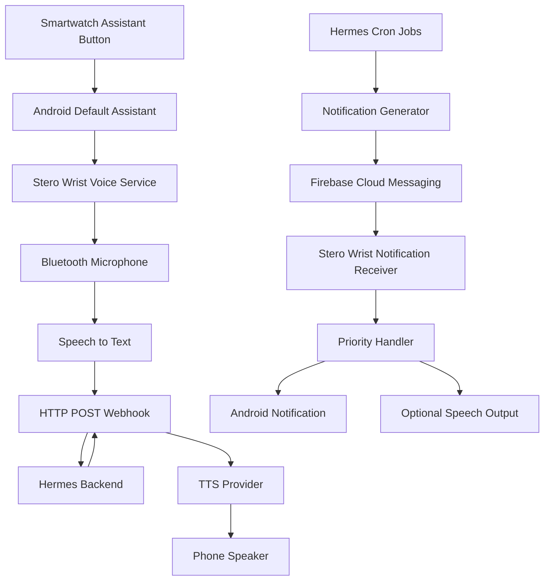
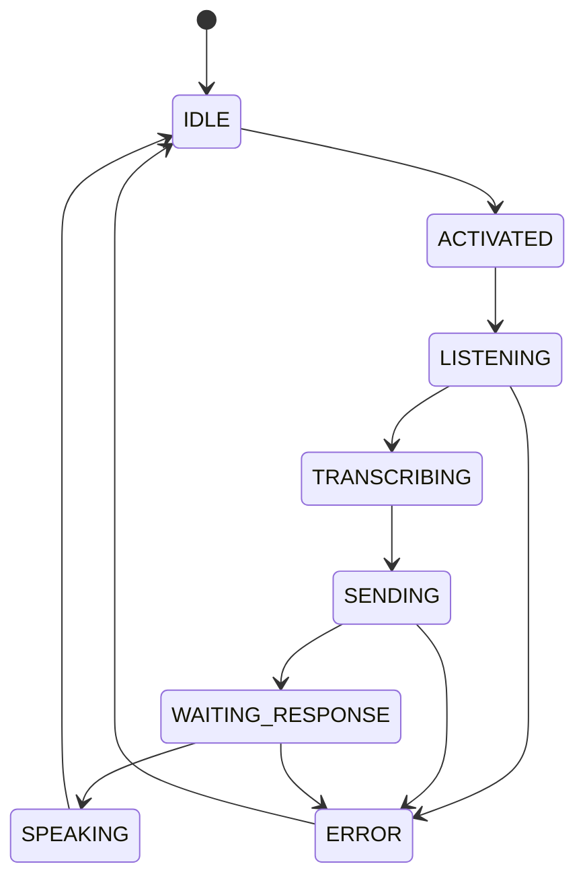
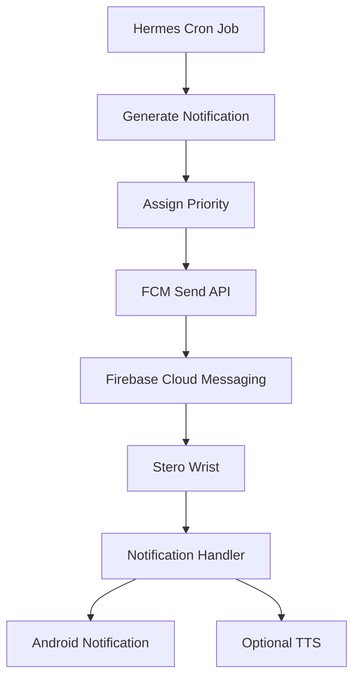

# Stero Wrist
## Product Requirements & Technical Architecture

**Project:** Stero Wrist  
**Type:** Android application + smartwatch voice interface  
**Primary integration:** Hermes AI Assistant  
**Platform:** Android  
**Architecture:** Backend-agnostic, provider-based, event-driven  
**Document status:** Initial Technical Specification (v1.0)

---

# 1. Product Overview

Stero Wrist is an Android companion application that turns a compatible smartwatch into a wireless voice input device and notification interface for AI assistants.

The primary objective is to allow users to communicate with an AI assistant such as Hermes through their smartwatch without needing to unlock or interact with their phone.

Stero Wrist has two independent communication channels:

### Channel A: On-demand voice interaction

The user presses the assistant button on their smartwatch, speaks a request, and receives a spoken response from the AI assistant.

Flow:

1. User presses the smartwatch assistant button.
2. Android activates Stero Wrist as the default digital assistant.
3. Stero Wrist captures speech through the smartwatch microphone when the Bluetooth audio route supports it.
4. Speech is converted into text.
5. The text is sent to the configured AI backend through an HTTP POST webhook.
6. The backend processes the request.
7. The backend returns a response.
8. Stero Wrist converts the response into speech using the configured TTS provider.
9. Audio is played through the phone speaker by default.
10. The application returns to idle and waits for another activation.

### Channel B: Proactive notifications

Hermes can independently send messages to Stero Wrist whenever a scheduled task, cron job, automation, or other backend event generates an update.

Flow:

1. A Hermes cron job or event executes.
2. Hermes generates a notification.
3. Hermes assigns a notification priority.
4. Hermes sends the notification through Firebase Cloud Messaging (FCM).
5. Stero Wrist receives the push notification.
6. The app evaluates its priority and user preferences.
7. The notification is displayed.
8. Depending on its priority and settings, the notification may also be spoken aloud.

This channel does not require the user to press the smartwatch button.

**Important:** Normal voice conversations use HTTP webhook requests and responses. Proactive updates use FCM. These are separate systems.

---

# 2. Product Goals

The application should:

- Enable smartwatch-triggered voice interaction.
- Work with the phone screen locked or off, subject to Android restrictions.
- Integrate with Hermes through configurable HTTP webhooks.
- Support speech-to-text and text-to-speech.
- Support both local and cloud-based TTS.
- Receive independent push notifications from Hermes.
- Deliver notifications according to priority.
- Support multiple assistant interaction modes.
- Allow users to configure backend providers.
- Maintain low battery consumption.
- Support future AI assistants without requiring architectural changes.

## Non-goals for the initial release

- Replacing the smartwatch operating system.
- Installing a custom operating system on the watch.
- Sending continuous raw audio streams to Hermes.
- Building a complete telephony platform inside Stero Wrist.
- Requiring a permanent WebSocket connection.
- Depending on proprietary smartwatch firmware modifications.

---

# 3. High-Level Architecture



## Main application modules

| Module | Responsibility |
|---|---|
| Assistant Integration | Android assistant activation |
| Audio Input | Bluetooth microphone capture |
| Speech Recognition | Speech-to-text |
| Webhook Client | HTTP communication with Hermes |
| TTS Engine | Text-to-speech |
| Audio Player | Plays generated speech |
| Notification Manager | Receives and displays notifications |
| FCM Client | Registers and receives push messages |
| Priority Engine | Determines notification behaviour |
| Settings Manager | Stores app configuration |
| Notification Inbox | Stores notification history |
| Backend Profiles | Manages multiple assistant configurations |

---

# 4. Smartwatch Integration

## 4.1 Assistant button activation

The application should integrate with Android's assistant framework.

Recommended Android components:

- `VoiceInteractionService`
- `VoiceInteractionSessionService`
- `VoiceInteractionSession`
- Appropriate Android manifest declarations and assistant role configuration.

The application should request the necessary user permissions and guide the user to set Stero Wrist as the default digital assistant.

The smartwatch's existing assistant button appears to invoke Android's configured default assistant. This behaviour must be validated on the target watch and phone.

The application should not initially depend on reverse-engineering proprietary Bluetooth button events.

## 4.2 Smartwatch responsibilities

The smartwatch is primarily an input interface.

Responsibilities:

- Detect assistant button activation through the existing Android assistant integration.
- Provide microphone input through its Bluetooth audio connection when available.
- Allow the user to activate another voice request.

The phone performs the processing, networking, speech recognition, and speech output.

## 4.3 Audio input routing

The application must investigate Bluetooth Hands-Free Profile (HFP) audio routing.

Important components:

- `AudioManager`
- `AudioRecord`
- Android communication device routing.
- Bluetooth SCO/HFP where supported.
- Speech recognition audio input configuration.

Do not assume that Android's speech recognition service automatically uses the smartwatch microphone.

The implementation must verify the actual recording device.

If the watch microphone cannot be selected or used reliably, the application should report the issue and provide an alternative input route.

---

# 5. Voice Interaction Engine

## 5.1 Default mode: Single Request

The default interaction mode should be Single Request.

Expected behaviour:

1. User activates the assistant.
2. App starts listening.
3. User speaks.
4. App detects the end of the utterance.
5. Speech recognition finalizes the transcript.
6. App sends one webhook request.
7. App receives the response.
8. App speaks the response.
9. App returns to idle.

The user must activate the assistant again for another request.

## 5.2 Silence detection

The application should support configurable end-of-utterance detection.

Initial recommended silence threshold: approximately 1.2 seconds.

This should be adjustable after testing.

The implementation must distinguish between:

- A short pause within a sentence.
- The end of an utterance.
- Background noise.
- Recognition errors.
- An empty recording.

The application must not prematurely submit speech simply because the user briefly pauses.

## 5.3 Voice interaction modes

| Mode | Description |
|---|---|
| Single Request | One utterance per activation |
| Conversation | Automatically listen for the next turn after a response |
| Continuous | Continue listening and segment multiple utterances |
| Notification Only | Disable voice input while retaining FCM notifications |

Single Request should be the default.

Conversation and Continuous modes must respect Android microphone and background execution restrictions.

## 5.4 Voice state machine



The application should expose meaningful states for debugging and user feedback.

---

# 6. Hermes Webhook Integration

## 6.1 Communication method

Normal voice interactions use HTTP POST.

The webhook URL must be configurable.

Example:

```http
POST https://your-hermes-server.example/webhook
Content-Type: application/json
Authorization: Bearer YOUR_TOKEN
```

Example request:

```json
{
  "text": "What is the status of my deployment?",
  "source": "stero-wrist",
  "session_id": "session-123",
  "mode": "single_request",
  "timestamp": "2026-11-12T14:30:00Z"
}
```

This is an illustrative contract. The actual request format must be adapted to the existing Hermes webhook.

## 6.2 Example response

```json
{
  "response": "Your deployment completed successfully.",
  "session_id": "session-123"
}
```

The response parser should support a configurable JSON response mapping so the application is not tied to one backend response schema.

## 6.3 Webhook settings

Users should be able to configure:

- Webhook URL.
- HTTP method.
- Authentication type.
- API key or bearer token.
- Custom HTTP headers.
- Request JSON template.
- Response JSON field mapping.
- Request timeout.
- Retry policy.
- Default assistant profile.

## 6.4 Error handling

Handle:

- Network unavailable.
- Connection timeout.
- HTTP 400 errors.
- HTTP 401/403 authentication failures.
- HTTP 429 rate limits.
- HTTP 500 backend errors.
- Invalid JSON.
- Empty response.
- Unexpected response format.

The app should not speak a successful answer when the webhook request failed.

An understandable error message should be displayed or spoken depending on user preferences.

## 6.5 Security

- Use HTTPS.
- Encrypt stored credentials.
- Avoid hardcoding backend secrets in the APK.
- Do not log authentication headers.
- Provide a way to update or remove credentials.

---

# 7. Text-to-Speech Architecture

TTS must be provider-independent.

The user should be able to select between on-device speech synthesis and cloud-based speech generation.

## 7.1 Supported TTS categories

### A. Android built-in TTS

Use Android's native `TextToSpeech` engine.

Advantages:

- No external API.
- Low latency.
- No per-request cloud cost.
- Can work offline when a voice is installed.
- Suitable for ordinary notifications.

Disadvantages:

- Voice quality varies by installed engine.
- Expressiveness may be limited.
- Voice availability depends on the device.

### B. OpenAI TTS

Integrate OpenAI's speech generation API through a backend provider adapter.

Possible configuration:

- Model.
- Voice.
- Instructions or speaking style where supported.
- Audio format.
- Speed where supported.

### C. Fish Audio

Integrate Fish Audio using its HTTP API.

Illustrative request:

```bash
curl https://api.fish.audio/v1/tts \
  -H "Authorization: Bearer $FISH_API_KEY" \
  -H "Content-Type: application/json" \
  -H "model: s2.1-pro-free" \
  -d '{
    "text": "[chuckle] When you are building something new, there is this [audience laughing] mix of wonder and fear. [whisper] But that is what makes it worth building.",
    "reference_id": "YOUR_REFERENCE_ID",
    "format": "mp3"
  }' \
  --output speech.mp3
```

The model and voice reference must be configurable and validated against the provider's current API requirements.

### D. Custom HTTP TTS

Support additional providers through a configurable integration interface.

This allows future integrations without rewriting the voice interaction system.

## 7.2 TTS provider interface

Suggested Kotlin interface:

```kotlin
interface TtsProvider {

    suspend fun synthesize(
        text: String,
        voice: String?,
        options: TtsOptions
    ): AudioResult

}
```

Suggested implementations:

```text
TtsProvider
    |
    |-- AndroidTtsProvider
    |
    |-- OpenAITtsProvider
    |
    |-- FishAudioTtsProvider
    |
    |-- CustomHttpTtsProvider
```

Each cloud provider should return audio in a supported format.

The common audio player should handle playback independently of the provider.

## 7.3 TTS configuration

The settings interface should provide:

- TTS provider.
- Model.
- Voice.
- Voice reference ID.
- API key.
- Speaking speed.
- Audio format.
- Language.
- Speaking style.
- Test voice button.

Only expose settings supported by the selected provider.

## 7.4 Different TTS engines for different events

Allow users to configure separate TTS policies.

Example:

| Event | TTS engine |
|---|---|
| Normal Hermes response | Selected cloud voice |
| Critical notification | Selected cloud voice |
| High-priority notification | Selected cloud voice |
| Normal notification | Android TTS |
| Low-priority notification | Silent |

A user should also be able to select one engine for everything.

## 7.5 Audio playback

Default output: phone speaker.

Future configurable routes:

- Phone speaker.
- Bluetooth earbuds.
- Watch speaker, if supported.
- Other connected Bluetooth audio devices.

Audio playback must not unintentionally switch to the watch speaker just because the watch microphone was used.

The input and output audio routes should be controlled independently wherever Android permits.

## 7.6 Cloud TTS security

Cloud TTS credentials should preferably be stored and used on a trusted backend.

The recommended architecture is:

```text
Stero Wrist
     |
     | HTTPS request
     v
TTS Gateway
     |
     | Provider API credentials
     v
OpenAI / Fish Audio / Other Provider
     |
     v
Generated Audio
     |
     v
Stero Wrist Audio Player
```

The gateway can also handle provider failover, caching, quotas, and usage tracking.

---

# 8. Proactive Notification Architecture

This is a separate system from the voice webhook.

## 8.1 Notification source

Notifications may originate from:

- Hermes cron jobs.
- Scheduled automations.
- Background agent tasks.
- Monitoring events.
- Deployment systems.
- External integrations.
- Manually triggered Hermes messages.

## 8.2 FCM architecture



Hermes should communicate with FCM through its server-side integration.

The Android application registers its FCM device token and securely associates it with the user's account or Hermes profile.

The device token must be refreshed when Firebase provides an updated token.

## 8.3 Example FCM notification payload

```json
{
  "type": "hermes_notification",
  "notification_id": "notification-001",
  "title": "Deployment completed",
  "message": "Your voice agent was successfully deployed.",
  "priority": "normal",
  "speak": false,
  "timestamp": "2026-11-12T14:30:00Z",
  "source": "deployment_cron"
}
```

Example critical alert:

```json
{
  "type": "hermes_notification",
  "notification_id": "notification-002",
  "title": "Production server down",
  "message": "The production server is unreachable.",
  "priority": "critical",
  "speak": true,
  "timestamp": "2026-11-12T14:35:00Z",
  "source": "server_monitor"
}
```

The notification payload is illustrative and should be adapted to the backend implementation.

## 8.4 Notification priority levels

Stero Wrist should support four logical priorities.

| Priority | Notification behaviour | Voice behaviour |
|---|---|---|
| Critical | Prominent notification | Speak immediately, subject to OS restrictions |
| High | Normal notification with high importance | Speak aloud |
| Normal | Regular notification | Silent |
| Low | Quiet or grouped notification | Silent |

Hermes determines the priority.

Stero Wrist determines how that priority is presented according to user settings.

### Important distinction

FCM transport priority and application notification priority are different.

- FCM delivery priority controls delivery urgency.
- Stero Wrist application priority controls presentation and speech behaviour.

Do not automatically assign FCM high delivery priority to every high-importance application notification.

## 8.5 Priority configuration

The user should be able to override the default policy.

Example:

```text
Critical:
    Show notification: YES
    Speak: YES

High:
    Show notification: YES
    Speak: YES

Normal:
    Show notification: YES
    Speak: NO

Low:
    Show notification: YES
    Speak: NO
```

Additional controls:

- Quiet hours.
- Do Not Disturb behaviour.
- Critical alert exceptions.
- Notification sound.
- Speech volume.
- Notification batching.
- Duplicate suppression.
- Reminder escalation.

Android notification permissions, channel importance, Do Not Disturb rules, and background audio restrictions must be respected.

---

# 9. Notification Intelligence

Notification delivery should eventually become more intelligent than simply announcing every incoming message.

## 9.1 Notification batching

Example:

Instead of speaking five separate updates:

"Five background tasks completed. Four succeeded and one requires your attention."

## 9.2 Duplicate suppression

If Hermes sends the same alert repeatedly, Stero Wrist should avoid repeatedly speaking it.

Use a notification ID and optional deduplication key.

## 9.3 Notification acknowledgement

Users should be able to acknowledge notifications.

Possible actions:

- Acknowledge.
- Dismiss.
- Remind me later.
- Ask Hermes.
- Open details.

## 9.4 Escalation

If a critical notification is not acknowledged, Hermes may send a reminder after a configurable interval.

Escalation should be controlled by the backend to avoid unnecessary duplicate alerts.

## 9.5 Notification history

Maintain an inbox with:

- Title.
- Message.
- Priority.
- Source.
- Timestamp.
- Delivery status.
- Spoken status.
- Acknowledgement status.

---

# 10. Notification Interaction

Notifications should eventually support contextual voice interactions.

Example:

Hermes sends:

"Your production server CPU usage is above 90%."

The user presses the watch assistant button and says:

"Tell me more about the server alert."

Stero Wrist sends the text through the normal Hermes webhook.

Hermes should have access to relevant notification context through a notification ID or session reference.

Example request:

```json
{
  "text": "Tell me more about the server alert.",
  "source": "stero-wrist",
  "context": {
    "notification_id": "notification-002"
  }
}
```

This allows the assistant to understand what the user is referring to without requiring them to repeat the entire alert.

Sensitive actions such as restarting services, deleting data, or changing production configurations should require appropriate authorization and confirmation.

---

# 11. Application Settings

The application should have the following settings sections.

## 11.1 Assistant settings

- Assistant enabled/disabled.
- Default interaction mode.
- Listening timeout.
- Silence detection threshold.
- Language.
- Speech recognition provider.
- Error handling.
- Session behaviour.

## 11.2 Webhook settings

- Backend profile.
- Webhook URL.
- HTTP method.
- Authentication.
- Headers.
- Request template.
- Response mapping.
- Timeout.
- Retry policy.

## 11.3 TTS settings

- Provider.
- Model.
- Voice.
- API credentials.
- Voice reference ID.
- Speed.
- Language.
- Audio format.
- Test voice.

## 11.4 Notification settings

- Enable FCM notifications.
- Priority rules.
- Speak notifications.
- Quiet hours.
- Batching.
- Duplicate suppression.
- Notification history.
- Critical alert policy.

## 11.5 Audio settings

- Input device.
- Output device.
- Speaker volume.
- Audio focus.
- Bluetooth routing.
- Playback interruption behaviour.

## 11.6 Backend profiles

Allow multiple backend profiles.

Example:

```text
Personal Hermes
Development Hermes
Production Hermes
Custom AI Backend
```

Each profile should have its own webhook configuration and optional TTS configuration.

---

# 12. Android Technical Stack

Recommended implementation stack:

| Component | Technology |
|---|---|
| Language | Kotlin |
| UI | Jetpack Compose |
| Assistant integration | VoiceInteractionService |
| Background execution | Foreground services where required |
| Audio input | AudioRecord / Android audio APIs |
| Speech recognition | Android SpeechRecognizer or alternative STT |
| Networking | OkHttp or Ktor |
| Local storage | Room |
| Preferences | DataStore |
| Secure credentials | Android Keystore-backed encryption |
| Push notifications | Firebase Cloud Messaging |
| Notifications | NotificationCompat |
| TTS | Android TextToSpeech + cloud adapters |
| Audio playback | Android Media3 or suitable audio APIs |
| Dependency injection | Hilt, optional |

## 12.1 Android permissions

The implementation should evaluate and request only necessary permissions.

Potential permissions include:

- `RECORD_AUDIO`
- `INTERNET`
- `FOREGROUND_SERVICE`
- `FOREGROUND_SERVICE_MICROPHONE`
- `POST_NOTIFICATIONS`
- `BLUETOOTH_CONNECT` where required.

Additional service declarations and restrictions depend on the selected Android version and execution model.

The application must comply with Android's microphone foreground-service restrictions and background-start limitations.

The ability to activate and record while the screen is locked must be validated on real hardware.

---

# 13. Backend Architecture

Hermes should remain the primary AI backend for the first release.

However, Stero Wrist should not be tightly coupled to Hermes-specific implementation details.

Recommended backend components:

```text
Hermes Backend
    |
    |-- Voice Webhook
    |
    |-- Cron Job Scheduler
    |
    |-- Notification Generator
    |
    |-- Priority Assignment
    |
    |-- FCM Integration
    |
    |-- Optional TTS Gateway
    |
    |-- Delivery Tracking
```

## 13.1 Cron job notifications

A cron job should:

1. Execute at its scheduled time.
2. Collect relevant information.
3. Determine whether a notification is required.
4. Generate a human-readable message.
5. Assign priority.
6. Choose whether the message should be spoken.
7. Send the message through FCM.
8. Record the delivery attempt.

Not every cron job needs to generate a notification.

Notification rules should support conditions to prevent unnecessary alerts.

## 13.2 Delivery tracking

The backend should eventually track:

- Notification generated.
- FCM send accepted.
- Device received.
- Notification displayed.
- Notification spoken.
- Notification acknowledged.
- Notification dismissed.

FCM acceptance does not guarantee device delivery or that the user heard the message.

Use a separate acknowledgement mechanism if Hermes needs to know what happened on the device.

---

# 14. Reliability and Offline Behaviour

The application should gracefully handle connectivity failures.

## Voice interaction

If the phone has no internet:

- Display or speak a connectivity error.
- Avoid silently losing the request.
- Optionally retain the transcript for a manual retry.

Do not automatically execute an old queued command later without user confirmation.

## Proactive notifications

If the device is temporarily disconnected:

- FCM should attempt delivery according to its TTL and delivery behaviour.
- The backend should retain important events when necessary.
- The backend should resend or reconcile undelivered events where appropriate.
- Notification IDs should prevent duplicate announcements.

For critical events, the backend should retain an event record rather than relying solely on FCM as permanent storage.

---

# 15. Security and Privacy

Security must be considered throughout the design.

Requirements:

- HTTPS for all backend requests.
- Secure storage of credentials.
- No permanent provider API keys inside the APK.
- Authenticated device registration.
- Device token rotation.
- Notification payload validation.
- Avoid sensitive content in push payloads where possible.
- User-controlled microphone activation.
- Clear recording and privacy indicators where required.
- No recording or uploading of raw audio unless explicitly required.
- Confirmation for sensitive assistant actions.
- User-controlled notification and speech permissions.

The initial design sends recognized text to Hermes, not continuous raw audio.

---

# 16. Battery Optimization

Stero Wrist should avoid unnecessary background processing.

Principles:

- Do not maintain a permanent WebSocket connection just for notifications.
- Use FCM for incoming messages.
- Activate microphone capture only when required by the selected mode.
- Release audio resources after each request.
- Avoid continuous polling.
- Cache configuration locally.
- Use Android's supported background execution mechanisms.

Continuous listening should be an optional advanced mode, not the default.

---

# 17. User Experience

## Main application screen

The main screen should show:

- Assistant connection status.
- Current backend profile.
- Selected TTS engine.
- Notification connection status.
- Last assistant interaction.
- Recent notifications.
- Quick access to settings.

## Voice interaction indicators

Suggested states:

```text
Idle
Listening
Processing speech
Sending request
Waiting for Hermes
Generating speech
Speaking
Error
```

The phone screen does not need to turn on for every interaction.

The application should be designed to work without requiring the user to unlock the phone, subject to Android restrictions.

## Notification inbox

Provide a searchable and filterable history.

Filters:

- All.
- Critical.
- High.
- Normal.
- Low.
- Unread.
- Acknowledged.

---

# 18. Development Roadmap

## Phase 1 — Android assistant integration

Deliverables:

- Kotlin Android project.
- Default assistant integration.
- Assistant button activation.
- Microphone capture.
- Bluetooth microphone testing.
- Speech-to-text.
- Screen-off and lock-screen testing.

Success criteria:

The watch button can reliably activate Stero Wrist and capture one spoken request.

## Phase 2 — Hermes webhook

Deliverables:

- Configurable webhook URL.
- HTTP POST request.
- JSON request serialization.
- Response parsing.
- Error handling.
- Session support.

Success criteria:

A spoken request reaches Hermes and its response is received.

## Phase 3 — TTS

Deliverables:

- Android built-in TTS.
- OpenAI adapter.
- Fish Audio adapter.
- Common audio player.
- Voice selection.
- Phone-speaker output.

Success criteria:

Hermes responses can be spoken through the phone speaker using the selected provider.

## Phase 4 — FCM integration

Deliverables:

- Firebase project configuration.
- Android device registration.
- FCM token management.
- Hermes notification endpoint.
- Notification payload parsing.
- Notification display.

Success criteria:

Hermes can send a push notification to Stero Wrist without any assistant button activation.

## Phase 5 — Priority-based speech

Deliverables:

- Critical/high/normal/low priorities.
- Priority-to-speech mapping.
- Separate notification and speech controls.
- Quiet hours.
- Audio interruption handling.

Success criteria:

Critical and high-priority messages are spoken according to settings, while routine messages remain regular notifications.

## Phase 6 — Notification intelligence

Deliverables:

- Notification inbox.
- Duplicate suppression.
- Batching.
- Acknowledgement.
- Reminder and escalation.
- Contextual follow-up through Hermes.

## Phase 7 — Advanced assistant modes

Deliverables:

- Conversation mode.
- Continuous mode.
- Multiple backend profiles.
- Custom TTS providers.
- Advanced audio routing.

---

# 19. Initial MVP Scope

The first working release should be intentionally small.

### Must have

- [ ] Android default assistant integration.
- [ ] Smartwatch assistant button activation.
- [ ] Bluetooth microphone input.
- [ ] Single Request interaction mode.
- [ ] Speech-to-text.
- [ ] Configurable Hermes HTTP POST webhook.
- [ ] Receive webhook response.
- [ ] Android built-in TTS.
- [ ] Phone-speaker playback.
- [ ] FCM device registration.
- [ ] Receive Hermes push notifications.
- [ ] Priority-based notification handling.
- [ ] Speak critical and high-priority notifications.
- [ ] Display normal and low-priority notifications.
- [ ] Basic settings.

### Later

- [ ] OpenAI TTS.
- [ ] Fish Audio TTS.
- [ ] Custom HTTP TTS providers.
- [ ] Notification inbox.
- [ ] Notification batching.
- [ ] Context-aware conversations.
- [ ] Multiple assistant profiles.
- [ ] Advanced voice modes.
- [ ] Notification acknowledgement and escalation.

---

# 20. Important Technical Risks

| Risk | Mitigation |
|---|---|
| Watch assistant button does not invoke third-party assistant reliably | Validate Android assistant integration on target devices |
| Bluetooth microphone is not selected automatically | Test HFP routing and implement explicit audio routing |
| Screen-off recording restrictions | Use supported assistant and microphone service mechanisms |
| Speech recognition unavailable offline | Provide configurable STT fallback |
| Cloud TTS latency | Support Android TTS fallback |
| FCM delivery delay | Use backend event persistence and delivery reconciliation |
| Repeated notifications | Deduplication and notification IDs |
| Cloud provider changes | Provider adapter architecture |
| Android kills background processes | Minimize persistent work and use appropriate Android services |

---

# 21. Final Architectural Principles

The following principles should guide all development:

1. **Watch is primarily an input device.** Phone performs processing and output.
2. **Button activation controls normal voice interactions.** No button press means no unsolicited voice conversation.
3. **Webhook handles conversations.** HTTP POST sends recognized text and receives the AI response.
4. **FCM handles proactive notifications.** Hermes cron jobs and events can independently reach the phone.
5. **Priority controls presentation.** Hermes assigns importance; Stero Wrist applies notification and speech rules.
6. **TTS is provider-independent.** Android, OpenAI, Fish Audio and future providers use a common interface.
7. **Phone speaker is the default output.** Bluetooth output routing can be configured separately.
8. **No permanent connection is required for notifications.** Use FCM.
9. **Hermes is the initial backend, not a permanent architectural limitation.**
10. **Security and Android restrictions are first-class requirements.**

---

# 22. Definition of Done

Stero Wrist v1.0 is ready when the following complete workflow works reliably:

### Voice interaction

The phone is locked. The user presses the assistant button on the smartwatch, speaks a question, and the phone captures speech through the watch microphone.

The app converts speech to text, sends it to Hermes through the configured webhook, receives the response, generates speech through the selected TTS engine, and plays the response through the phone speaker.

The app then returns to idle.

### Proactive notification

A Hermes cron job executes independently of the user's interaction.

Hermes generates a message, assigns its priority, and sends it through FCM.

The phone receives the notification while the app is not actively being used.

Stero Wrist displays it and applies the user's priority rules:

- Critical: spoken announcement and notification.
- High: spoken announcement and notification.
- Normal: regular notification.
- Low: quiet notification.

The user can review notification history later.

**That is the complete foundation of Stero Wrist: a smartwatch-triggered voice assistant combined with an independent, priority-aware notification channel for Hermes.**